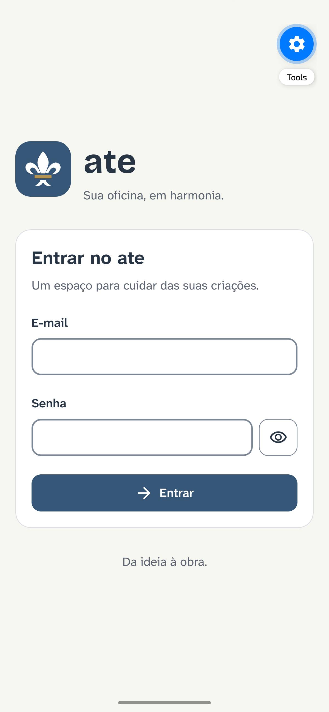
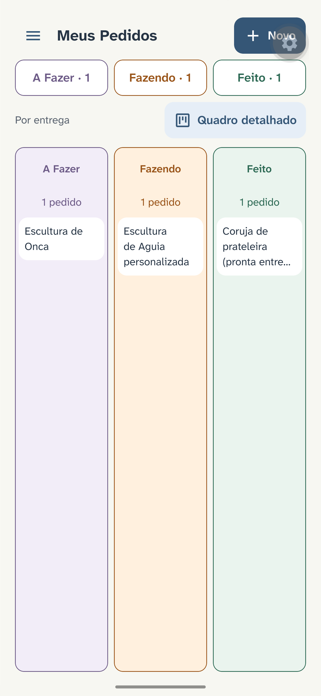
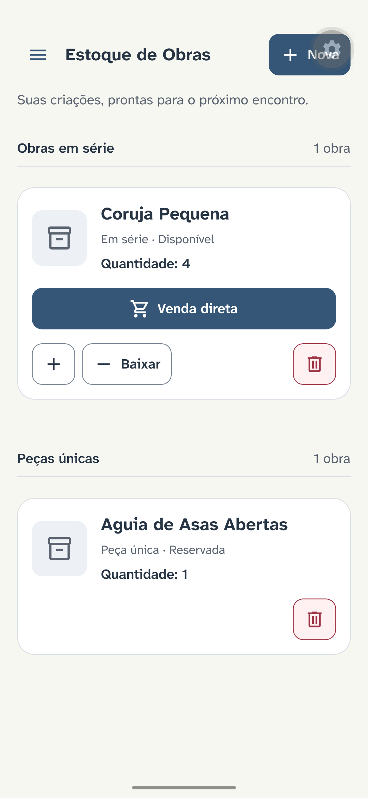

# ate

Aplicativo de gestão para artesãos: pedidos em Kanban, clientes, estoque de peças únicas e em série e eventos.


## Capturas de tela

   

Demais telas em [docs/screenshots/](docs/screenshots/).

## Funcionalidades

- Login do artesão.
- Kanban de pedidos em três colunas — A Fazer, Fazendo e Feito — com movimentação de cards e foto de conclusão obrigatória para fechar um pedido.
- Clientes: cadastro, seleção e edição.
- Estoque de obras: peças únicas e em série, com baixa automática ao vincular a um pedido, compensação ao cancelar e venda direta de peças em série.
- Eventos e feiras com data, endereço e coordenadas.

## Stack

- Expo SDK 57, React Native 0.86, Expo Router e TypeScript
- Jest e React Native Testing Library
- Arquitetura em camadas (Clean Architecture / DDD)

## Como rodar

Pré-requisitos: Node >= 22.13, npm e Expo Go compatível com o SDK 57 em Android ou iOS.

```sh
npm ci
npx expo start
```

Conta de demonstração: **artesao@email.com** / **123456**.

## Testes

```sh
npm test
npm run typecheck
npm run lint
```

## Roadmap

- Persistência local com SQLite
- Sincronização com Supabase
- Câmera e GPS reais
- Mapa visual de eventos

## Documentação

A documentação está em [docs/](docs/): os documentos das fases 1 e 2 ([ate-fase1.md](docs/ate-fase1.md) e [ate-fase2.md](docs/ate-fase2.md)) e o guia de desenvolvimento ([DESENVOLVIMENTO.md](docs/DESENVOLVIMENTO.md)).
