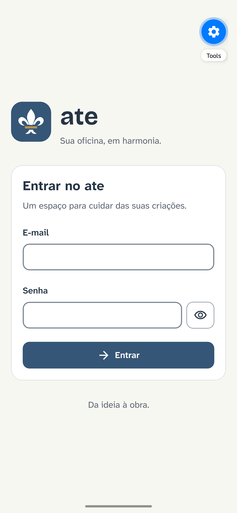
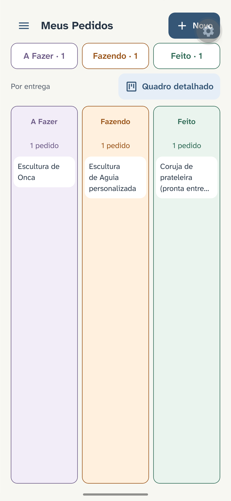
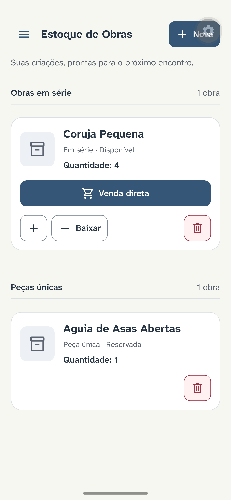
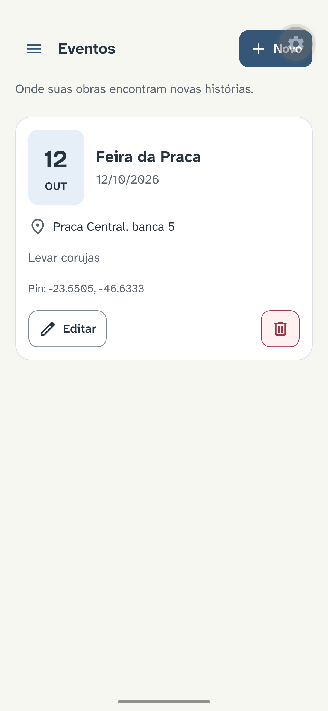

# ate

Aplicativo de gestão para artesãos: pedidos em Kanban, clientes, estoque de peças únicas e em série e eventos.


## Capturas de tela

   

Demais telas em [docs/screenshots/](docs/screenshots/).

## Funcionalidades

- Login do artesão com Supabase Auth, sessão cifrada no aparelho e uso offline.
- Kanban de pedidos em três colunas — A Fazer, Fazendo e Feito — com movimentação de cards e foto de conclusão obrigatória para fechar um pedido.
- Clientes: cadastro, seleção e edição.
- Estoque de obras: peças únicas e em série, com baixa automática ao vincular a um pedido, compensação ao cancelar e venda direta de peças em série.
- Eventos e feiras com local escolhido no mapa (busca de endereço, GPS ou ajuste do pin) e mapa com os pins dos eventos, que funciona offline nas áreas dos eventos.
- Offline-first: tudo é gravado no SQLite do aparelho e sincronizado com o Supabase (dados e fotos) quando há conexão, com o estado do envio visível no app.

## Stack

- Expo SDK 58, React Native 0.88, Expo Router e TypeScript
- SQLite (`expo-sqlite` + Drizzle ORM) como banco local
- Supabase (Auth, Postgres com RLS e Storage) como backend
- Câmera (`expo-camera`), localização (`expo-location`) e mapa nativo MapLibre com OpenFreeMap (sem chave de API, com a área de cada evento baixada para uso offline)
- Jest e React Native Testing Library
- Arquitetura em camadas (Clean Architecture / DDD)

## Como rodar

Pré-requisitos: Node >= 22.13, npm e Expo Go compatível com o SDK 58 em Android ou iOS.

```sh
npm ci
cp .env.example .env   # preencha com a URL e a chave publishable do seu projeto Supabase
npx expo start
```

O mapa nativo (MapLibre) só roda no app instalado (development build ou APK); no Expo Go o resto do app funciona e a tela do mapa mostra um aviso.

O backend é um projeto Supabase: o SQL (tabelas, RLS e bucket) está em [supabase/](supabase/) e o passo a passo em [supabase/LEIA-ME.md](supabase/LEIA-ME.md). A conta do artesão é criada no painel do Supabase; o app não tem cadastro. Sem `.env` o app mostra "Configuração incompleta".

## Testes

```sh
npm test
npm run typecheck
npm run lint
```

## Próximos passos

- Build com EAS e APK instalável (entrega final).

## Documentação

A documentação está em [docs/](docs/): os documentos das fases 1 a 4 ([ate-fase1.md](docs/ate-fase1.md), [ate-fase2.md](docs/ate-fase2.md), [ate-fase3.md](docs/ate-fase3.md) e [ate-fase4.md](docs/ate-fase4.md)) e o guia de desenvolvimento ([DESENVOLVIMENTO.md](docs/DESENVOLVIMENTO.md)).
