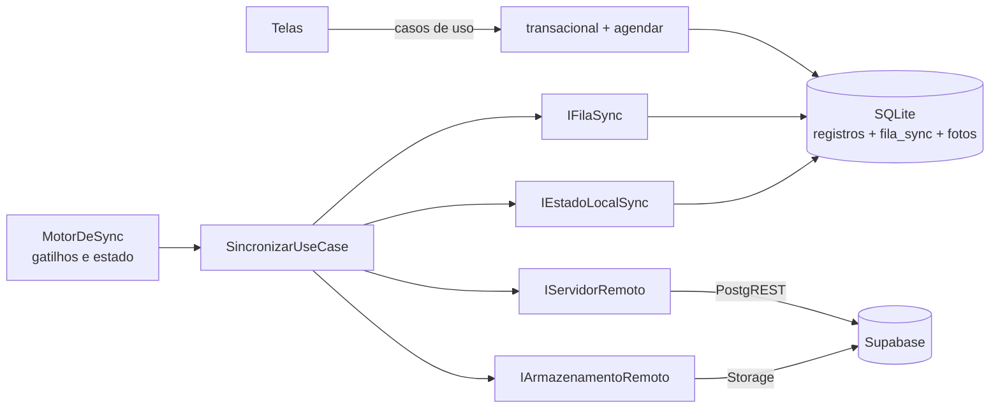

# Documento de Software — Fase 4 (Supabase, autenticação real e sincronização)

Fecha o desenvolvimento do `ate`. A fase 3 deixou o app 100% local (SQLite, câmera, GPS e mapa), com a fila outbox, a tabela `fotos` e o `sync_meta` preparados. Nesta fase o app passa a ter:
- login real no Supabase Auth, com sessão cifrada no aparelho;
- schema remoto com RLS e bucket privado de fotos;
- motor de sincronização completo nos dois sentidos.

Ficam para a entrega final (01/12): EAS, `expo-dev-client`, `expo-updates` e o APK.

Base: plano didático (aulas de 03/11, 06/11 e 10/11), roteiro `docs/superpowers/plans/2026-10-27-fase3-roteiro.md` (Planos 3 e 4), plano detalhado do Plano 3 e a revisão dele (`2026-10-27-fase3-plano3-revisao.md`). Decisões D3 (bucket privado) e D4 (proteção dos dados locais na troca de conta) confirmadas em 09/11/2026.

## 1. Projeto Supabase

- Projeto `mogzqhuwdztyrbmmyxul`, região São Paulo, plano Free.
- Uma conta (a do artesão), criada no painel com "Auto Confirm". O cadastro público está desligado (o app não tem tela de cadastro).
- "Automatic RLS" ligado: toda tabela nova em `public` já nasce com RLS.
- O SQL é versionado em `supabase/migrations/` e foi aplicado pelo **MCP oficial do Supabase** no Claude Code (`apply_migration`). O MCP fica restrito ao projeto pelo `project_ref`, só com os grupos `database`, `development`, `debugging`, `docs` e `storage`, e cada chamada pede aprovação. O passo a passo para refazer sem MCP está em `supabase/LEIA-ME.md`.

| Migration | Conteúdo |
|---|---|
| `0001_tabelas.sql` | `clientes`, `obras`, `pedidos`, `eventos` espelhando o SQLite, sem as colunas e tabelas só locais. `id` sem default (vem do aparelho). `usuario_id default auth.uid()`. Trigger que força `updated_at = now()`. Índices `(usuario_id, updated_at, id)` para o pull |
| `0002_rls.sql` | RLS com `select`, `insert` e `update` só do dono. Sem `delete` (exclusão lógica). Revoga o acesso da API à função interna do auto-RLS |
| `0003_storage.sql` | Bucket **privado** `fotos` (JPEG, até 5 MB), com objetos em `<usuario_id>/<foto_id>.jpg` e o mesmo escopo pela primeira pasta |

**Verificação de segurança (RNF03).** O `supabase/tests/rls_isolamento.sql` roda numa transação desfeita no fim. A conta real faz o papel do usuário A e um UUID sintético o do usuário B. O roteiro prova que:
- `usuario_id` vem do token;
- o `updated_at` enviado pelo aparelho é ignorado;
- pedido `FEITO` sem foto é recusado;
- B não lê, não altera, não grava em nome de A, não apaga e não acessa a pasta de fotos de A.

Resultado em 09/11: **RLS OK**, sem nenhuma linha restante depois do rollback. O Security Advisor ficou só com "Leaked password protection", recurso que existe apenas nos planos pagos (aceito).

## 2. Autenticação real (Plano 3 rebaseado)

### Arquitetura entregue

- `infrastructure/auth/ArmazenamentoCifradoDeSessao.ts`: padrão LargeSecureStore. A cada gravação nasce uma chave AES-256 nova, guardada no **`expo-secure-store`**; a sessão cifrada vai para o **kv-store do `expo-sqlite`**. Nunca há texto claro fora do cofre.
- `infrastructure/auth/CifradorAesGcm.ts`: AES-256-**GCM** nativo do `expo-crypto` (SDK 58), que detecta adulteração.
- `infrastructure/supabase/cliente.ts`: valida o `.env` (aceita só `sb_publishable_…`), cria o cliente com `persistSession`, `autoRefreshToken`, `detectSessionInUrl: false` e renovação do token só em primeiro plano (`AppState`).
- `infrastructure/auth/SupabaseAuthGateway.ts`: implementa o `IAuthGateway` sem mudar o contrato.
  - **Login:** traduz o erro pelo código (`invalid_credentials`, `email_not_confirmed`, rede).
  - **Restauração da sessão:** funciona offline e com rede lenta. O `getSession` tem limite de 5 s e cai na sessão guardada. Um refresh revogado apaga a sessão guardada.
  - **Logout local:** funciona offline, com limite de 3 s.
- D4:
  - `DonoDosDadosLocais` (SQLite);
  - decorator `protegerDonoDosDados` no login;
  - `protegerSessaoRestaurada` na abertura do app;
  - `apagarDadosEEntrar`, que **autentica a conta nova antes de apagar**.
- `main/auth/criarSupabaseDoApp.ts`: instância única (um só `GoTrueClient`) que entrega o auth e o destino remoto do sync.
- UI:
  - `restaurando` no `AuthProvider`: o `index` mostra "carregando" em vez de piscar o login;
  - mensagens reais de erro;
  - aviso de outra conta com confirmação;
  - tela "Configuração incompleta" sem `.env`.
- O `FakeAuthGateway` saiu do runtime e ficou só nos testes.

### Decisões e divergências

| # | Fase 2 / plano anterior | Fase 4 | Motivo |
|---|---|---|---|
| 1 | URLs públicas das fotos (UC16) | Bucket privado e caminho do objeto no banco (`foto_conclusao_path`, `foto_path`) | D3: fotos de clientes (LGPD) |
| 2 | Sessão cifrada com `aes-js` (AES-CTR) no AsyncStorage | AES-GCM nativo do `expo-crypto` + kv-store do `expo-sqlite` | Duas dependências a menos e cifra autenticada; o SecureStore guarda só a chave |
| 3 | Chave anon (JWT) aceita | Só `sb_publishable_…` | Elimina a leitura de JWT com `atob` (que não existe no Hermes) e qualquer chance de embutir a `service_role` |
| 4 | `react-native-url-polyfill` | Não instalado | O Expo já fornece `URL` global (guia oficial do Expo) |
| 5 | FKs simples `pedidos → clientes/obras` | FKs compostas `(id, usuario_id)` | O RLS sozinho não impede pedido de A apontar para cliente de B |
| 6 | `data_entrega`/`data` como `date` | `timestamptz` | O aparelho grava ISO completo; o vaivém do sync não pode deslocar o dia por fuso |
| 7 | "Apagar dados locais" e depois login | Login primeiro, depois apagar | Se a rede cair, nada é perdido |
| 8 | Restauração sem limite de tempo | 5 s no boot, 3 s no logout, 15 s no login | Revisão do Plano 3 (ponto 7): rede ruim não trava o app |
| 9 | `profiles` no DER remoto | Sem `profiles` | O app não usa perfil |

### Smoke test no aparelho (Expo Go, 09/11/2026)

Todos os itens passaram:
- login com a conta real e fluxo D4 sobre os dados do usuário falso ("Apagar dados locais e entrar");
- sessão mantida ao reabrir;
- abertura em modo avião;
- logout offline;
- mensagem de sem conexão;
- senha errada.

## 3. Motor de sincronização (Plano 4)

### Arquitetura (D5)

- **Núcleo (`core/application`):**
  - `SincronizarUseCase`;
  - as 4 portas;
  - as regras puras `organizarFila` (coalescência e pai antes de filho) e `proximaTentativa` (backoff `min(2^n × 2 s, 15 min)` × jitter de 0,5 a 1,5);
  - `ErroDeSincronizacao`, com os tipos `SEM_REDE`, `TRANSITORIO`, `PERMANENTE` e `SESSAO`.
- **Infraestrutura:**
  - `SQLiteFilaSync` e `SQLiteEstadoLocalSync`, que passam todas as operações pelo `ExecutorDeTransacao`. Na conexão única, uma escrita do sync no meio de um caso de uso entraria na transação dele.
  - `mapeamentoRemoto`: camelCase local ↔ snake_case remoto e caminhos de foto.
  - `SupabaseServidorRemoto`, com upsert por id e pull por cursor composto.
  - `SupabaseArmazenamentoRemoto`: upload de `ArrayBuffer` com `upsert`; download por URL assinada direto para o arquivo.
  - `traduzirErroSupabase` e `MonitorDeRedeExpo` (`expo-network`).
- **Composição (`main/sync/MotorDeSync`):** single-flight (do caso de uso), debounce de 3 s após escrita e estado observável pela UI. Ao fim de um ciclo que mudou dados, avisa os ouvintes; se ainda sobrou fila, agenda outro ciclo.

### Ciclo

1. **Fotos:** `PENDENTE_UPLOAD` referenciadas → `<uid>/<foto>.jpg` → `ENVIADA` + `caminho_remoto`. Uma foto que falha não segura os outros registros.
2. **Push da fila:**
   - entradas elegíveis por `proxima_tentativa_em`;
   - coalescência por linha, com o estado atual **relido do SQLite** (tombstone incluído);
   - clientes e obras antes de pedidos;
   - registro com foto não enviada espera (storage-first + `CHECK` no servidor);
   - sucesso → `SINCRONIZADO` com o `updated_at` do servidor, só se não entrou edição nova durante o envio;
   - sem rede → para, sem gastar tentativa;
   - transitório (5xx, 429, FK ainda sem o pai) → backoff;
   - permanente → `FALHA`/`ERRO` visível, com "Tentar enviar de novo";
   - sessão → para e avisa.
3. **Pull** por tabela, pai antes de filho, em lotes de 500 por `(updated_at, id)`:
   - o `updated_at` é guardado como string: o Postgres tem microssegundos e o `Date` só milissegundos;
   - lote e cursor na mesma transação;
   - linha local `PENDENTE`/`ERRO` não é sobrescrita;
   - tombstones aplicados.
4. **Fotos faltantes** (ex.: reinstalação): baixadas para `fotos/<foto>.jpg`. A UI continua usando o caminho relativo, sem mudança.

**Gatilhos:**
- entrar ou restaurar a sessão;
- reconexão (`expo-network`);
- volta ao primeiro plano (`AppState`);
- 3 s depois de cada escrita do usuário;
- botão "Sincronizar agora" no menu.

**Estado visível (RF17):**
- `OfflineBanner` com a conexão real;
- `PainelDeSync` no menu: tudo sincronizado, sincronizando, N aguardando envio, N recusadas, sem conexão ou sessão expirada;
- `IndicadorDeSync` nos cards de pedido, obra e evento ("Aguardando envio" / "Erro ao enviar").

### Decisões e divergências

| # | Roteiro / fase 2 | Fase 4 | Motivo |
|---|---|---|---|
| 1 | `@react-native-community/netinfo` | `expo-network` | Módulo Expo, incluído no Expo Go (regra do projeto: preferir módulos Expo) |
| 2 | UI reativa via `addDatabaseChangeListener` | O motor avisa o `DataProvider` ao fim de um ciclo que mudou dados | Mais simples e testável; as escritas da própria UI já recarregam |
| 3 | URL assinada para exibir fotos vindas do servidor | Download no pull para `fotos/` | Offline-first: depois de reinstalar, as fotos ficam disponíveis sem rede |
| 4 | Pull-to-refresh no Kanban | Não feito | O quadro é horizontal, com uma lista por coluna; "Sincronizar agora" e os gatilhos automáticos cobrem o caso |
| 5 | — | Cliente Avulso duplicado na reinstalação: o do servidor vence, o local vira tombstone e os pedidos são reapontados | O índice único local travaria o pull para sempre |
| 6 | — | Ciclo que gerou fila nova (item 5) agenda outro | No smoke test, o tombstone ficou esperando o próximo gatilho |
| 7 | FK como erro permanente | FK (`23503`) é transitório | O pai pode estar esperando a própria foto |
| 8 | Envio em lote | Um upsert por registro | Isola o registro recusado sem derrubar o lote; volume < 30 obras/ano (RNF08) |

### Smoke test no aparelho (Expo Go, 09/11/2026)

Passaram:
- ao abrir, os dados do Checkpoint B subiram sozinhos;
- criações e edições em modo avião (pedido concluído com foto, obra com foto, evento) subiram sozinhas ao voltar a rede;
- matar o app no meio do sync não duplicou nem perdeu nada;
- depois de apagar os dados do Expo Go e entrar de novo, dados e fotos voltaram.

Conferência pelo MCP:
- nenhum pedido `FEITO` sem foto;
- todo caminho de foto existe no bucket;
- um único dono.

Achado: um segundo Cliente Avulso vivo no servidor (o da reinstalação), corrigido pela divergência 6. Lentidão perceptível mas aceitável, vinda de um upsert por registro e do eco das próprias linhas no pull.

## 4. Fechamento

- **Baseline:** 85 suítes e 614 testes passando; `typecheck` limpo; `lint` com 0 erros (11 avisos herdados de `import/first` em `RouterGuards.test.tsx`); `db:check` ok; `expo-doctor` 20/20 depois de alinhar 8 pacotes ao patch do SDK 58.
- **Cobertura** (`npx jest --coverage`): linhas 93,6%, instruções 90,9%, funções 91,3%, ramos 81,6%.
- **Teste de arquitetura:** `core/` continua sem `expo`, `react`, `drizzle`, `@supabase/*` ou `uuid`; nenhum fake no runtime.

### Matriz de rastreabilidade RF → UC → teste

Complementa o Apêndice A.3 de `docs/ate-fase2.md` com as suítes reais (todas em `src/**/__tests__/`).

| RF | UC | Testes |
|---|---|---|
| RF01 Login | UC01 | `AuthUseCases`, `SupabaseAuthGateway`, `ArmazenamentoCifradoDeSessao`, `cliente`, `TelaLogin`, `AuthRestauracao`, `RouterGuards` |
| RF02 Logout | UC02 | `AuthUseCases`, `SupabaseAuthGateway` (logout offline e lento), `RouterGuards` |
| RF03 Kanban | UC03 | `TelaKanban`, `KanbanPresentation`, `DeliveryOrder` |
| RF04 Mover card | UC04, UC05 | `Pedido`, `PedidoClose`, `TelaKanban` |
| RF05 Foto obrigatória | UC05, UC06 | `Pedido`, `PedidoClose`, `CameraModal`, `CameraHost`, `ExpoCameraGateway`, `ArmazenamentoDeFotos`, `MigrationsSupabase` (`CHECK` remoto), `SincronizacaoPontaAPonta` |
| RF06 Cadastrar cliente | UC09 | `Cliente`, `ClienteUseCases`, `SQLiteClienteRepository`, `ClientSelection` |
| RF07 Registrar pedido | UC07, UC08 | `PedidoWrite`, `TelaNovoPedido`, `ClientSelection` |
| RF08 Consultar estoque | UC11 | `ObraUseCases`, `TelaEstoque`, `StockSections` |
| RF09 Cadastrar obra | UC12 | `Obra`, `ObraUseCases`, `FotoCatalogo` |
| RF10 Baixa de estoque | UC10 | `Obra`, `PedidoWrite`, `PedidoClose`, `makeSqliteProviders` (rollback) |
| RF11 Vincular obra | UC10 | `WorkSelection`, `PedidoWrite` |
| RF12 Cadastrar evento | UC13, UC14 | `Evento`, `Coordenada`, `EventoUseCases`, `ExpoLocationGateway`, `ExpoGeocodingGateway`, `SeletorDeLocal`, `GeolocalizacaoPersistencia` |
| RF13 Mapa de eventos | UC15 | `MapaLeaflet`, `TelaEventos` |
| RF14 Operar offline | UC07, UC09, UC11, UC12 | repositórios `SQLite*`, `ExecutorDeTransacao`, `OutboxSyncGateway`, `makeSqliteProviders`, `SincronizacaoPontaAPonta` (modo avião) |
| RF15 Fila e sync | UC16 | `SincronizarUseCase`, `SyncRegras`, `SQLiteSync`, `SupabaseSync`, `SincronizacaoPontaAPonta` |
| RF16 Upload de imagens | UC17 | `SincronizarUseCase` (fotos), `SupabaseSync` (Storage), `SQLiteSync`, `SincronizacaoPontaAPonta`, `ArmazenamentoDeFotos` (compressão) |
| RF17 Banner de conectividade | UC18 | `Shell` (`OfflineBanner`), `Sincronizacao` (`PainelDeSync`, `IndicadorDeSync`, `NetworkProvider`) |
| RF18 Editar cliente | UC19 | `ClienteUseCases`, `TelaEditarCliente` |
| RF19 Editar pedido | UC20 | `PedidoWrite`, `TelaEditarPedido`, `RoteamentoEdicao` |
| RF20 Cancelar pedido | UC21 | `PedidoClose`, `TelaKanban` |
| RF21 Adicionar unidades | UC22 | `Obra`, `ObraUseCases`, `SQLiteObraRepository` |
| RF22 Remover obra | UC23 | `ObraUseCases`, `TelaEstoque` |
| RF23 Editar evento | UC24 | `EventoUseCases`, `TelaEditarEvento`, `GeolocalizacaoPersistencia` |
| RF24 Remover evento | UC25 | `EventoUseCases`, `TelaEventos` |
| RF25 Remover unidades | UC26 | `Obra`, `ObraUseCases`, `TelaEstoque` |
| RF26 Venda direta | UC27 | `VendaDireta`, `TelaEstoque`, `SincronizacaoPontaAPonta` (balcão) |

RNFs com teste automatizado:
- **RNF02:** `ExecutorDeTransacao` e `makeSqliteProviders`.
- **RNF03:** `rls_isolamento.sql` e `MigrationsSupabase`.
- **RNF04:** `MigrationsSupabase` (trigger), `SQLiteSync` (cursor com o `updated_at` do servidor) e `rls_isolamento.sql`.
- **RNF06:** `ArmazenamentoDeFotos`.
- **RNF09:** `Arquitetura`.
- **RNF11:** `Pedido` e o `CHECK` remoto.
- **RNF12:** `CameraModal` e `ExpoLocationGateway`.

## 5. Pendências para a entrega final (01/12)

- `eas.json` com os perfis `development` e `preview` (APK), `android.package`, `expo-dev-client` e `expo-updates` com `runtimeVersion`.
- Variáveis `EXPO_PUBLIC_SUPABASE_URL` e `EXPO_PUBLIC_SUPABASE_PUBLISHABLE_KEY` no EAS (`eas env`), porque o `.env` fica fora do git.
- Repetir os smoke tests B e C no APK instalado (os textos de permissão próprios só aparecem fora do Expo Go).
- Opcional, se a lentidão incomodar: upsert em lote por tabela, com fallback por registro quando o lote for recusado.
