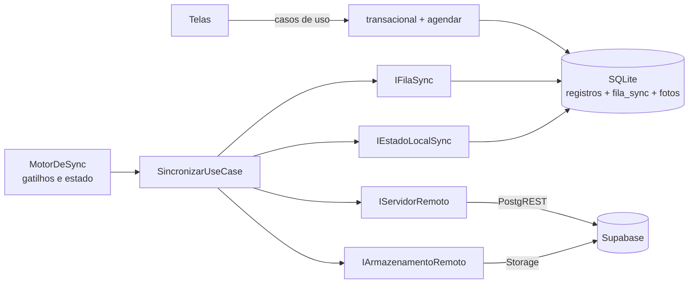

# Documento de Software — Fase 4 (Supabase, autenticação real e sincronização)

Fecha o desenvolvimento do `ate`. A fase 3 deixou o app 100% local (SQLite, câmera, GPS e mapa), com a fila outbox, a tabela `fotos` e o `sync_meta` preparados. Nesta fase o app passa a ter:
- login real no Supabase Auth, com sessão cifrada no aparelho;
- schema remoto com RLS e bucket privado de fotos;
- motor de sincronização completo nos dois sentidos.

Ficam para a entrega final (01/12): EAS, `expo-dev-client`, `expo-updates` e o APK.

Base: plano didático (aulas de 03/11, 06/11 e 10/11), roteiro `docs/superpowers/plans/2026-10-27-fase3-roteiro.md` (Planos 3 e 4), plano detalhado do Plano 3 e a revisão dele (`2026-10-27-fase3-plano3-revisao.md`). Decisões D3 (bucket privado) e D4 (proteção dos dados locais na troca de conta) confirmadas em 09/11/2026.

## 1. Projeto Supabase

- Projeto `mogzqhuwdztyrbmmyxul`, região São Paulo, plano Free.
- Uma conta (a do artesão), criada no painel com "Auto Confirm". O cadastro público está desligado (o app não tem tela de cadastro).
- "Automatic RLS" ligado: toda tabela nova em `public` já nasce com RLS.
- O SQL é versionado em `supabase/migrations/` e foi aplicado pelo **MCP oficial do Supabase** no Claude Code (`apply_migration`). O MCP fica restrito ao projeto pelo `project_ref`, só com os grupos `database`, `development`, `debugging`, `docs` e `storage`, e cada chamada pede aprovação. O passo a passo para refazer sem MCP está em `supabase/README.md`.

| Migration | Conteúdo |
|---|---|
| `0001_tabelas.sql` | `clientes`, `obras`, `pedidos`, `eventos` espelhando o SQLite, sem as colunas e tabelas só locais. `id` sem default (vem do aparelho). `usuario_id default auth.uid()`. Trigger que força `updated_at = now()`. Índices `(usuario_id, updated_at, id)` para o pull |
| `0002_rls.sql` | RLS com `select`, `insert` e `update` só do dono. Sem `delete` (exclusão lógica). Revoga o acesso da API à função interna do auto-RLS |
| `0003_storage.sql` | Bucket **privado** `fotos` (JPEG, até 5 MB), com objetos em `<usuario_id>/<foto_id>.jpg` e o mesmo escopo pela primeira pasta |

**Verificação de segurança (RNF03).** O `supabase/tests/rls_isolamento.sql` roda numa transação desfeita no fim. A conta real faz o papel do usuário A e um UUID sintético o do usuário B. O roteiro prova que:
- `usuario_id` vem do token;
- o `updated_at` enviado pelo aparelho é ignorado;
- pedido `FEITO` sem foto é recusado;
- B não lê, não altera, não grava em nome de A, não apaga e não acessa a pasta de fotos de A.

Resultado em 09/11: **RLS OK**, sem nenhuma linha restante depois do rollback. O Security Advisor ficou só com "Leaked password protection", recurso que existe apenas nos planos pagos (aceito).

## 2. Autenticação real (Plano 3 rebaseado)

### Arquitetura entregue

- `infrastructure/auth/ArmazenamentoCifradoDeSessao.ts`: padrão LargeSecureStore. A cada gravação nasce uma chave AES-256 nova, guardada no **`expo-secure-store`**; a sessão cifrada vai para o **kv-store do `expo-sqlite`**. Nunca há texto claro fora do cofre.
- `infrastructure/auth/CifradorAesGcm.ts`: AES-256-**GCM** nativo do `expo-crypto` (SDK 58), que detecta adulteração.
- `infrastructure/supabase/cliente.ts`: valida o `.env` (aceita só `sb_publishable_…`), cria o cliente com `persistSession`, `autoRefreshToken`, `detectSessionInUrl: false` e renovação do token só em primeiro plano (`AppState`).
- `infrastructure/auth/SupabaseAuthGateway.ts`: implementa o `IAuthGateway` sem mudar o contrato.
  - **Login:** traduz o erro pelo código (`invalid_credentials`, `email_not_confirmed`, rede).
  - **Restauração da sessão:** funciona offline e com rede lenta. O `getSession` tem limite de 5 s e cai na sessão guardada. Um refresh revogado apaga a sessão guardada.
  - **Logout local:** funciona offline, com limite de 3 s.
- D4:
  - `DonoDosDadosLocais` (SQLite);
  - decorator `protegerDonoDosDados` no login;
  - `protegerSessaoRestaurada` na abertura do app;
  - `apagarDadosEEntrar`, que **autentica a conta nova antes de apagar**.
- `main/auth/criarSupabaseDoApp.ts`: instância única (um só `GoTrueClient`) que entrega o auth e o destino remoto do sync.
- UI:
  - `restaurando` no `AuthProvider`: o `index` mostra "carregando" em vez de piscar o login;
  - mensagens reais de erro;
  - aviso de outra conta com confirmação;
  - tela "Configuração incompleta" sem `.env`.
- O `FakeAuthGateway` saiu do runtime e ficou só nos testes.

### Decisões e divergências

| # | Fase 2 / plano anterior | Fase 4 | Motivo |
|---|---|---|---|
| 1 | URLs públicas das fotos (UC16) | Bucket privado e caminho do objeto no banco (`foto_conclusao_path`, `foto_path`) | D3: fotos de clientes (LGPD) |
| 2 | Sessão cifrada com `aes-js` (AES-CTR) no AsyncStorage | AES-GCM nativo do `expo-crypto` + kv-store do `expo-sqlite` | Duas dependências a menos e cifra autenticada; o SecureStore guarda só a chave |
| 3 | Chave anon (JWT) aceita | Só `sb_publishable_…` | Elimina a leitura de JWT com `atob` (que não existe no Hermes) e qualquer chance de embutir a `service_role` |
| 4 | `react-native-url-polyfill` | Não instalado | O Expo já fornece `URL` global (guia oficial do Expo) |
| 5 | FKs simples `pedidos → clientes/obras` | FKs compostas `(id, usuario_id)` | O RLS sozinho não impede pedido de A apontar para cliente de B |
| 6 | `data_entrega`/`data` como `date` | `timestamptz` | O aparelho grava ISO completo; o vaivém do sync não pode deslocar o dia por fuso |
| 7 | "Apagar dados locais" e depois login | Login primeiro, depois apagar | Se a rede cair, nada é perdido |
| 8 | Restauração sem limite de tempo | 5 s no boot, 3 s no logout, 15 s no login | Revisão do Plano 3 (ponto 7): rede ruim não trava o app |
| 9 | `profiles` no DER remoto | Sem `profiles` | O app não usa perfil |

### Smoke test no aparelho (Expo Go, 09/11/2026)

Todos os itens passaram:
- login com a conta real e fluxo D4 sobre os dados do usuário falso ("Apagar dados locais e entrar");
- sessão mantida ao reabrir;
- abertura em modo avião;
- logout offline;
- mensagem de sem conexão;
- senha errada.

## 3. Motor de sincronização (Plano 4)

### Arquitetura (D5)



- **Núcleo (`core/application`):**
  - `SincronizarUseCase`;
  - as 4 portas;
  - as regras puras `organizarFila` (coalescência e pai antes de filho) e `proximaTentativa` (backoff `min(2^n × 2 s, 15 min)` × jitter de 0,5 a 1,5);
  - `ErroDeSincronizacao`, com os tipos `SEM_REDE`, `TRANSITORIO`, `PERMANENTE` e `SESSAO`.
- **Infraestrutura:**
  - `SQLiteFilaSync` e `SQLiteEstadoLocalSync`, que passam todas as operações pelo `ExecutorDeTransacao`. Na conexão única, uma escrita do sync no meio de um caso de uso entraria na transação dele.
  - `mapeamentoRemoto`: camelCase local ↔ snake_case remoto e caminhos de foto.
  - `SupabaseServidorRemoto`, com upsert por id e pull por cursor composto.
  - `SupabaseArmazenamentoRemoto`: upload de `ArrayBuffer` com `upsert`; download por URL assinada direto para o arquivo.
  - `traduzirErroSupabase` e `MonitorDeRedeExpo` (`expo-network`).
- **Composição (`main/sync/MotorDeSync`):** single-flight (do caso de uso), debounce de 3 s após escrita e estado observável pela UI. Ao fim de um ciclo que mudou dados, avisa os ouvintes; se ainda sobrou fila, agenda outro ciclo.

### Ciclo

1. **Fotos:** `PENDENTE_UPLOAD` referenciadas → `<uid>/<foto>.jpg` → `ENVIADA` + `caminho_remoto`. Uma foto que falha não segura os outros registros.
2. **Push da fila:**
   - entradas elegíveis por `proxima_tentativa_em`;
   - coalescência por linha, com o estado atual **relido do SQLite** (tombstone incluído);
   - clientes e obras antes de pedidos;
   - registro com foto não enviada espera (storage-first + `CHECK` no servidor);
   - sucesso → `SINCRONIZADO` com o `updated_at` do servidor, só se não entrou edição nova durante o envio;
   - sem rede → para, sem gastar tentativa;
   - transitório (5xx, 429, FK ainda sem o pai) → backoff;
   - permanente → `FALHA`/`ERRO` visível, com "Tentar enviar de novo";
   - sessão → para e avisa.
3. **Pull** por tabela, pai antes de filho, em lotes de 500 por `(updated_at, id)`:
   - o `updated_at` é guardado como string: o Postgres tem microssegundos e o `Date` só milissegundos;
   - lote e cursor na mesma transação;
   - linha local `PENDENTE`/`ERRO` não é sobrescrita;
   - tombstones aplicados.
4. **Fotos faltantes** (ex.: reinstalação): baixadas para `fotos/<foto>.jpg`. A UI continua usando o caminho relativo, sem mudança.

**Gatilhos:**
- entrar ou restaurar a sessão;
- reconexão (`expo-network`);
- volta ao primeiro plano (`AppState`);
- 3 s depois de cada escrita do usuário;
- (o botão "Sincronizar agora" foi retirado nos refinamentos de 20/11: a sincronização é só automática).

**Estado visível (RF17):**
- `OfflineBanner`: linha discreta e cinza no topo das telas, só quando offline ("Sem conexão · salvo no aparelho"). O laranja foi abandonado porque é a cor da coluna "Fazendo";
- `StatusDaNuvem`: uma linha só no menu, com ícone de nuvem ("Tudo sincronizado", "Sincronizando…", "Sem conexão…"). Só no raro caso de recusa do servidor vira "Algo não foi enviado · toque para tentar de novo";
- `IndicadorDeSync`: selo "Não enviado" no card só quando o servidor recusou o registro.

Refinamento de 20/11 (pedido do usuário): a primeira versão tinha "Sincronizar agora", contagem de pendências e selos "Aguardando envio" em cada card. Era informação demais para um app que deve ser simples, e o aviso de offline aparecia duplicado no menu.

### Decisões e divergências

| # | Roteiro / fase 2 | Fase 4 | Motivo |
|---|---|---|---|
| 1 | `@react-native-community/netinfo` | `expo-network` | Módulo Expo, incluído no Expo Go (regra do projeto: preferir módulos Expo) |
| 2 | UI reativa via `addDatabaseChangeListener` | O motor avisa o `DataProvider` ao fim de um ciclo que mudou dados | Mais simples e testável; as escritas da própria UI já recarregam |
| 3 | URL assinada para exibir fotos vindas do servidor | Download no pull para `fotos/` | Offline-first: depois de reinstalar, as fotos ficam disponíveis sem rede |
| 4 | Pull-to-refresh no Kanban | Não feito | O quadro é horizontal, com uma lista por coluna; os gatilhos automáticos (abrir, reconectar, voltar ao app, após cada alteração) cobrem o caso |
| 5 | — | Cliente Avulso duplicado na reinstalação: o do servidor vence, o local vira tombstone e os pedidos são reapontados | O índice único local travaria o pull para sempre |
| 6 | — | Ciclo que gerou fila nova (item 5) agenda outro | No smoke test, o tombstone ficou esperando o próximo gatilho |
| 7 | FK como erro permanente | FK (`23503`) é transitório | O pai pode estar esperando a própria foto |
| 8 | Envio em lote | Um upsert por registro | Isola o registro recusado sem derrubar o lote; volume < 30 obras/ano (RNF08) |

### Smoke test no aparelho (Expo Go, 09/11/2026)

Passaram:
- ao abrir, os dados do Checkpoint B subiram sozinhos;
- criações e edições em modo avião (pedido concluído com foto, obra com foto, evento) subiram sozinhas ao voltar a rede;
- matar o app no meio do sync não duplicou nem perdeu nada;
- depois de apagar os dados do Expo Go e entrar de novo, dados e fotos voltaram.

Conferência pelo MCP:
- nenhum pedido `FEITO` sem foto;
- todo caminho de foto existe no bucket;
- um único dono.

Achado: um segundo Cliente Avulso vivo no servidor (o da reinstalação), corrigido pela divergência 6. Lentidão perceptível mas aceitável, vinda de um upsert por registro e do eco das próprias linhas no pull.

## 4. Fechamento

- **Baseline:** 85 suítes e 614 testes passando; `typecheck` limpo; `lint` com 0 erros (11 avisos herdados de `import/first` em `RouterGuards.test.tsx`); `db:check` ok; `expo-doctor` 20/20 depois de alinhar 8 pacotes ao patch do SDK 58.
- **Cobertura** (`npx jest --coverage`): linhas 93,6%, instruções 90,9%, funções 91,3%, ramos 81,6%.
- **Teste de arquitetura:** `core/` continua sem `expo`, `react`, `drizzle`, `@supabase/*` ou `uuid`; nenhum fake no runtime.

### Matriz de rastreabilidade RF → UC → teste

Complementa o Apêndice A.3 de `docs/ate-fase2.md` com as suítes reais (todas em `src/**/__tests__/`).

| RF | UC | Testes |
|---|---|---|
| RF01 Login | UC01 | `AuthUseCases`, `SupabaseAuthGateway`, `ArmazenamentoCifradoDeSessao`, `cliente`, `TelaLogin`, `AuthRestauracao`, `RouterGuards` |
| RF02 Logout | UC02 | `AuthUseCases`, `SupabaseAuthGateway` (logout offline e lento), `RouterGuards` |
| RF03 Kanban | UC03 | `TelaKanban`, `KanbanPresentation`, `DeliveryOrder` |
| RF04 Mover card | UC04, UC05 | `Pedido`, `PedidoClose`, `TelaKanban` |
| RF05 Foto obrigatória | UC05, UC06 | `Pedido`, `PedidoClose`, `CameraModal`, `CameraHost`, `ExpoCameraGateway`, `ArmazenamentoDeFotos`, `MigrationsSupabase` (`CHECK` remoto), `SincronizacaoPontaAPonta` |
| RF06 Cadastrar cliente | UC09 | `Cliente`, `ClienteUseCases`, `SQLiteClienteRepository`, `ClientSelection`, `TelaClientes` |
| RF07 Registrar pedido | UC07, UC08 | `PedidoWrite`, `TelaNovoPedido`, `ClientSelection` |
| RF08 Consultar estoque | UC11 | `ObraUseCases`, `TelaEstoque`, `StockSections` |
| RF09 Cadastrar obra | UC12 | `Obra`, `ObraUseCases`, `FotoCatalogo` |
| RF10 Baixa de estoque | UC10 | `Obra`, `PedidoWrite`, `PedidoClose`, `makeSqliteProviders` (rollback) |
| RF11 Vincular obra | UC10 | `WorkSelection`, `PedidoWrite` |
| RF12 Cadastrar evento | UC13, UC14 | `Evento`, `Coordenada`, `EventoUseCases`, `ExpoLocationGateway` (inclui `ultimaConhecida`), `ExpoGeocodingGateway`, `SeletorDeLocal`, `GeolocalizacaoPersistencia`, `PhotonEnderecos`, `EnderecoDoEvento` |
| RF13 Mapa de eventos | UC15 | `MapaNativo`, `TelaEventos`, `MapaOfflineMapLibre`, `AreasOffline` (regra e caso de uso), `geometria` |
| RF14 Operar offline | UC07, UC09, UC11, UC12 | repositórios `SQLite*`, `ExecutorDeTransacao`, `OutboxSyncGateway`, `makeSqliteProviders`, `SincronizacaoPontaAPonta` (modo avião) |
| RF15 Fila e sync | UC16 | `SincronizarUseCase`, `SyncRegras`, `SQLiteSync`, `SupabaseSync`, `SincronizacaoPontaAPonta` |
| RF16 Upload de imagens | UC17 | `SincronizarUseCase` (fotos), `SupabaseSync` (Storage), `SQLiteSync`, `SincronizacaoPontaAPonta`, `ArmazenamentoDeFotos` (compressão) |
| RF17 Banner de conectividade | UC18 | `Shell` (`OfflineBanner`), `Sincronizacao` (`StatusDaNuvem`, `IndicadorDeSync`, `NetworkProvider`) |
| RF18 Editar cliente | UC19 | `ClienteUseCases`, `TelaEditarCliente`, `TelaClientes` |
| RF19 Editar pedido | UC20 | `PedidoWrite`, `TelaEditarPedido`, `RoteamentoEdicao` |
| RF20 Cancelar pedido | UC21 | `PedidoClose`, `TelaKanban` |
| RF21 Adicionar unidades | UC22 | `Obra`, `ObraUseCases`, `SQLiteObraRepository` |
| RF22 Remover obra | UC23 | `ObraUseCases`, `TelaEstoque` |
| RF23 Editar evento | UC24 | `EventoUseCases`, `TelaEditarEvento`, `GeolocalizacaoPersistencia`, `TelaEventos` (realizado sem Editar) |
| RF24 Remover evento | UC25 | `EventoUseCases`, `TelaEventos` |
| RF25 Remover unidades | UC26 | `Obra`, `ObraUseCases`, `TelaEstoque` (uma confirmação, revisado em 28/11) |
| RF26 Venda direta | UC27 | `VendaDireta`, `TelaEstoque`, `SincronizacaoPontaAPonta` (balcão) |

RNFs com teste automatizado:
- **RNF02:** `ExecutorDeTransacao` e `makeSqliteProviders`.
- **RNF03:** `rls_isolamento.sql` e `MigrationsSupabase`.
- **RNF04:** `MigrationsSupabase` (trigger), `SQLiteSync` (cursor com o `updated_at` do servidor) e `rls_isolamento.sql`.
- **RNF06:** `ArmazenamentoDeFotos`.
- **RNF09:** `Arquitetura`.
- **RNF11:** `Pedido` e o `CHECK` remoto.
- **RNF12:** `CameraModal` e `ExpoLocationGateway`.

## 5. Ajustes pós-avaliação (20/11/2026)

O professor apontou um problema: o mapa era uma aplicação web (Leaflet numa WebView, com a biblioteca baixada do `unpkg.com`) e por isso não funcionava offline: sem internet, o mapa nem aparecia. Supabase e as demais áreas foram aprovadas. Os ajustes seguem o material das aulas de geolocalização (`01-fundamentos-geolocalizacao`, `02-expo-location-maps`) e de Supabase (`03-supabase-backend-seguro`).

### Mapa nativo: MapLibre + OpenFreeMap

- `presentation/components/mapa/MapaNativo.tsx` substitui o `MapaLeaflet` com a mesma interface: `Map` e `Camera` (`initialViewState`, `flyTo`), pin com `ViewAnnotation` arrastável (`onDragEnd`) e toque no mapa devolvendo a coordenada (`nativeEvent.lngLat`). É o mesmo modelo da aula 2 (Region, Marker, toque com `nativeEvent.coordinate`, `animateToRegion`).
- `infrastructure/device/mapa/geometria.ts` faz as conversões `{latitude, longitude}` ↔ `[longitude, latitude]` (a ordem inversa que o material alerta). A caixa em volta de um ponto usa 1° de latitude ≈ 111 km e a longitude encolhendo com cos(latitude), como na aula de fundamentos.
- **Offline de verdade:** uma porta nova, `IMapaOffline`, mais a regra pura `planejarAreasOffline` e o `SincronizarAreasOfflineUseCase`, mantêm uma área baixada por evento: raio de 1,5 km, zoom de 10 a 16, pelo `OfflineManager` do MapLibre (`MapaOfflineMapLibre`). Com internet, a reconciliação roda sempre que a lista de eventos muda (inclusive depois do pull). Downloads interrompidos são retomados. Fora dessas áreas, sem rede, o mapa fica sem as ruas, mas pins, pin novo, GPS e coordenadas continuam funcionando.
- **Abrir o mapa rápido (aula 2, slide 13):** `ILocationGateway.ultimaConhecida()` usa `getLastKnownPositionAsync` sem pedir permissão (RNF12) para abrir o seletor perto do usuário.
- **"Como chegar"** continua abrindo o app Google Maps (decisão do usuário).
- O `react-native-webview` saiu do projeto.

| # | Material / fase anterior | Agora | Motivo |
|---|---|---|---|
| 1 | `react-native-maps` com `PROVIDER_GOOGLE` (aula 2) | MapLibre React Native 11.5 | No Android, `react-native-maps` exige chave do Google Maps com faturamento; o MapLibre é nativo, open source e não tem chave |
| 2 | Leaflet + OSM numa WebView (D6 da fase 3) | Mapa nativo com áreas offline | Feedback do professor: a WebView dependia da internet até para carregar a biblioteca |
| 3 | Imagens do OpenStreetMap (`tile.openstreetmap.org`) | Estilo vetorial do OpenFreeMap | A política do OSM não permite baixar áreas para uso offline; o OpenFreeMap permite (até 3.000 imagens ou 50 MB por área, com User-Agent próprio) e não tem chave. A atribuição fica visível no mapa |
| 4 | MapViewDirections e Places Autocomplete (aula 2) | Fora: "Como chegar" abre o Google Maps e a busca usa o geocoder do `expo-location` | Exigem APIs pagas do Google e chave |
| 5 | Rodar no Expo Go | Mapa só no app instalado (development build/APK) | O MapLibre não faz parte do Expo Go. O resto do app continua no Expo Go, e o mapa mostra um aviso |

### Supabase: alinhamento com a aula 3

- **Sessão encerrada pelo servidor (slide 14, `onAuthStateChange`):** `SupabaseAuthGateway.aoEncerrarSessao` escuta `SIGNED_OUT` (ex.: refresh revogado com o app aberto), e o `AuthProvider` volta ao login. Falha de rede ao renovar não gera `SIGNED_OUT`: o uso offline não muda.
- **O que já atendia:**
  - RLS com `(select auth.uid())` e `to authenticated` (slides 18–21);
  - bucket privado com pasta por usuário e URL assinada (slides 24–28);
  - só o caminho do arquivo no Postgres (slide 31);
  - 401, offline e timeout com retentativa exponencial (slide 39);
  - Context API e `Stack.Protected` (slides 41–45);
  - LargeSecureStore (slide 48);
  - fila offline e sincronização (aula 2, slides 40–41).
- **Divergências do material (justificadas pela documentação do Expo):**
  - sem `react-native-url-polyfill`, porque o Expo já fornece `URL`;
  - a cifra da sessão fica no kv-store do `expo-sqlite`, não no AsyncStorage;
  - AES-GCM nativo do `expo-crypto` no lugar do `aes-js` (CTR). O padrão LargeSecureStore é o mesmo: chave AES no SecureStore e sessão cifrada fora dele.

### Testes e baseline

Os testes novos cobrem `MapaNativo`, `SeletorDeLocal` (última posição, arrastar o pin, Expo Go), `geometria`, `MapaOfflineMapLibre` com o `OfflineManager` dublado, a regra e o caso de uso das áreas offline, `ExpoLocationGateway.ultimaConhecida` e a sessão encerrada pelo servidor. O dublê do MapLibre fica em `src/test-support/mocks/maplibre.tsx`.

Baseline: 88 suítes e 629 testes passando; `typecheck` limpo; `lint` com 0 erros; `db:check` ok; `expo-doctor` 20/20 depois de alinhar 16 pacotes ao patch atual do SDK 58.

**A validar no aparelho (primeiro passo da fase de EAS):**
1. seletor e mapa de eventos com internet;
2. cadastrar um evento com internet (a área baixa sozinha);
3. modo avião → reabrir o mapa do evento: ruas da área, pin e GPS.

## 6. Build, APK e atualizações (EAS, 20/11/2026)

- **Projeto EAS:** `@ricardo1755/ate`. O app se chama **Ate** (o `slug` continua `ate`) e o pacote Android é `com.rmofilh.ate`.
- **Ícone e tela de abertura:** a flor-de-lis da marca (`fleur-de-lis-light.svg`) sobre o azul `#355676`, com ícone adaptativo e monocromático (ícones temáticos do Android 13+), no lugar dos ícones de exemplo do Expo.
- **`eas.json`:**

  | Perfil | O que gera | Uso |
  |---|---|---|
  | `development` | APK de depuração com `expo-dev-client` (canal `development`) | Testes no celular conectados ao `npx expo start` |
  | `preview` | APK de release, instalável direto (canal `preview`) | Apresentação e uso real |
  | `production` | AAB (canal `production`) | Só se um dia for para a loja |

- **Variáveis:** `EXPO_PUBLIC_SUPABASE_URL` e `EXPO_PUBLIC_SUPABASE_PUBLISHABLE_KEY` cadastradas no EAS (`eas env:create`, visibilidade plaintext, ambientes `development` e `preview`). O `.env` local não vai para o servidor de build.
- **Tamanho:** `expo-build-properties` com `buildArchs: ["arm64-v8a"]` (só processadores ARM 64 bits, praticamente todo Android de 2017 para cá), R8 (`enableMinifyInReleaseBuilds`) e remoção de recursos não usados (`enableShrinkResourcesInReleaseBuilds`). Medido: development build 323,5 MB; preview sem otimização 168,2 MB; preview otimizado **54,0 MB** (build `315aafa2…`, 68% menor que o anterior).
- **Atualização automática (EAS Update, `expo-updates`):** `runtimeVersion` com a política `fingerprint`. Mudanças só de código chegam ao APK instalado sem build novo:

  ```bash
  npx eas-cli@latest update --channel preview --environment preview --message "descrição"
  ```

  O app baixa a atualização ao abrir e aplica na abertura seguinte. Uma mudança nativa (pacote novo, ícone, permissão, plugin) muda o fingerprint e exige um APK novo.
- **Atenção, Supabase Free:** o projeto **pausa depois de 7 dias sem uso** e o endereço sai do ar; o app mostra "Sem conexão" no login. Isso aconteceu em 20/11 (o último uso tinha sido em 09/11). Para reativar: painel do Supabase → projeto → Restore. Antes da apresentação, abrir o app e conferir o login.
- **Autocorreção do sync (20/11):** no aparelho, um evento ficou PENDENTE mesmo já estando no servidor, com a fila vazia. Agora cada ciclo recoloca na fila as linhas PENDENTE sem entrada (`reenfileirarOrfas`). O reenvio é idempotente, e o item volta a SINCRONIZADO.

## 7. Pendências para a entrega final (01/12)

- Repetir o smoke test completo no APK final instalado: login, pedidos com foto, estoque, eventos com mapa online e em modo avião, sincronização.
- Na véspera da apresentação, abrir o app para o Supabase não pausar e conferir o login.
- Ajustes só de código depois do APK: `npm run update:apk -- --message "..."`. Ajustes nativos: `npm run build:apk`.

## 8. Ajustes finais pós-apresentação (28/11/2026)

Depois da apresentação final (bem recebida, com o APK funcionando), o uso do app trouxe 5 pontos. Cada um foi avaliado contra o que estava documentado antes de mudar.

| # | Ponto | O que estava documentado | Decisão |
|---|---|---|---|
| 1 | "Editar" em eventos já realizados | RF23/UC24 não restringia por data | Evento realizado é histórico: sem "Editar", com "Ver no mapa" e "Remover". Um erro se corrige removendo e recriando com a data passada (o app aceita). Só a UI muda (`EventoCard`) |
| 2 | Endereço pouco aproveitado: não dava para saber que o texto posicionava o mapa, e o pin não trazia endereço | `IGeocodingGateway.buscar` (geocoder do `expo-location`) e o botão "Localizar no mapa" | Sugestões ao digitar (autocomplete) e endereço a partir do pin (geocoding reverso), mais uma dica discreta no campo. Detalhes abaixo |
| 3 | Baixa de unidades com 2 confirmações e um botão "Continuar para segunda confirmação" | RF25 pedia "dupla confirmação explícita", implementada no caso de uso (`duplaConfirmacao`) | **RF25 revisado:** uma confirmação explícita, com a quantidade no botão ("Baixar 2 unidades"). A intenção era evitar o toque acidental, não criar burocracia. O "+1" segue sem confirmação, porque é reversível pela própria baixa |
| 4 | Faltava uma tela de clientes | Nenhum UC listava clientes: o cliente só aparecia dentro do pedido (UC08/09/19) | Tela **Clientes** no menu: lista em ordem alfabética (sem o Cliente Avulso, que é interno), pedidos em aberto de cada um, tocar para editar e botão "Novo". Reaproveita as telas `cliente/novo` e `cliente/[id]` |
| 5 | Pastas `docs`, `.claude`, `.opencode`, `.vscode` "indo junto" | — | Elas **nunca estiveram dentro do APK** (ele só leva o código compilado e as imagens), mas iam no **pacote enviado ao servidor de build**. Agora o build usa `.easignore` + `EAS_NO_VCS=1` |

### Endereço: sugestões e caminho inverso (ponto 2)

- A porta `IGeocodingGateway` ganhou `sugerir(texto)` e `enderecoDe(coordenada)`, que nunca lançam: sem rede, devolvem nada.
- O adaptador `PhotonEnderecos` usa o **Photon** (komoot), uma busca sobre o OpenStreetMap, sem chave e sem cadastro. É coerente com o mapa MapLibre + OpenFreeMap e com a decisão de não usar Google (é o equivalente aberto do Places Autocomplete da aula 2).
  - As sugestões são puxadas para perto da última posição conhecida, sem pedir permissão, e ficam só no Brasil.
  - O rótulo segue o formato "Rua, nº – Bairro, Cidade - UF".
  - O limite é de 5 s, e o User-Agent identifica o app.
- `useEnderecoDoEvento` + `CampoDeEndereco`:
  - debounce de 400 ms, a partir de 3 letras, só com internet;
  - escolher uma sugestão preenche o endereço **e** marca o local;
  - ao confirmar o pin no mapa, o endereço do ponto preenche o campo se ele estiver vazio; se o usuário já digitou algo, vira a oferta "Endereço do ponto: … · Usar este", e o texto nunca é trocado sem ele pedir.
- O "Localizar no mapa" (geocoder nativo) e as coordenadas manuais continuam valendo.

### Build limpo (ponto 5)

- O `.easignore` repete o `.gitignore` e acrescenta `docs`, `supabase`, `.claude`, `.opencode`, `.vscode`, `README.md`, `AGENTS.md`, `skills-lock.json`, os testes (`__tests__`, `src/test-support`, configs do Jest) e as configs de ferramentas.
- Mesmo com o `.easignore`, o modo padrão (via Git) envia a pasta `.git`. Ela carrega o histórico, inclusive os PDFs das apresentações. Com `EAS_NO_VCS=1`, o pacote é montado direto da pasta e respeita o `.easignore`.
- Resultado (conferido com `eas build:inspect --stage archive`): **de 43,2 MB para 2,2 MB**, só com `src`, `assets`, `drizzle` e as configurações. `.env`, testes e documentação ficam de fora.
- Comandos prontos no `package.json`:
  - `npm run build:apk` gera o APK (`preview`);
  - `npm run update:apk -- --message "..."` publica uma atualização só de código.
- `.gitignore`: passou a ignorar `.claude/settings.local.json` (configuração pessoal).
- **Lição do primeiro build (falhou):** no `.easignore`, um nome sem `/` no início vale para **qualquer pasta com esse nome**. `supabase` excluiu também `src/infrastructure/supabase/` (código do app), e o build quebrou no empacotamento do JavaScript ("Unable to resolve module …/supabase/cliente"). As exclusões agora são ancoradas na raiz (`/supabase`, `/docs`…). Antes de cada build, a conferência é feita assim:
  - montar o pacote com `eas build:inspect --stage archive`;
  - comparar a lista de arquivos de `src`, `assets` e `drizzle` com a do Git;
  - rodar `expo export --platform android` dentro do pacote.

Baseline: 91 suítes e 650 testes passando, `typecheck` limpo e `lint` com 0 erros (11 avisos herdados).
